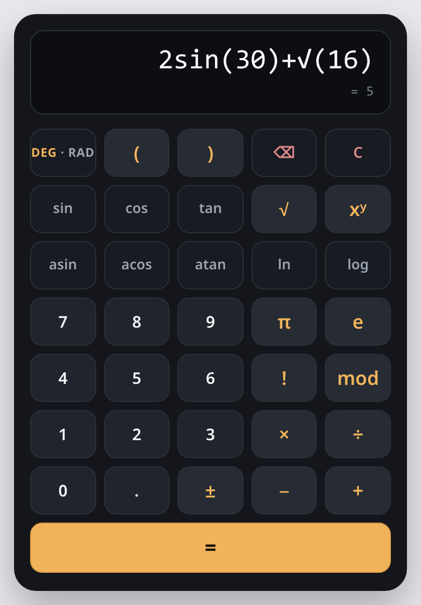

# Exam Calculator

Scientific calculator in a single HTML file, built for Moodle quizzes taken in
Safe Exam Browser. No network requests, no storage, no `eval()`, no
dependencies.

**Live demo:** <https://idrago.github.io/exam-calculator/> shows the calculator in
a pop-up-style window. The calculator page itself is
[calculator.html](https://idrago.github.io/exam-calculator/calculator.html).



## Features

- Arithmetic `+ − × ÷`, power, modulo, factorial, parentheses.
- `sin cos tan asin acos atan` in degrees or radians, `√`, `ln`, `log`
  (base 10), constants `π` and `e`.
- Live preview of the result while typing.
- `Ans`: after `=`, an operator continues from the full-precision result
  (`Ans×2`, `Ans^2`).
- Implicit multiplication: `2π`, `2(3)`, `2sin(30)`, `(1+2)(3+4)`.
- `±` negates the trailing operand.
- Mouse, touch and physical keyboard input.
- One file, `calculator.html`, with inline CSS and JavaScript. The math engine
  is a tokenizer, a shunting-yard parser (RPN) and a stack evaluator; the keypad
  is plain DOM built from a `KEYS` table.

## Use in a Moodle quiz

The calculator is shown either in a pop-up window or in an iframe.

### Pop-up window

`calculator.html` is added to the course as a File resource whose display is
set to **In pop-up**, with pop-up width 420 and height 610. Moodle then opens
the file in a separate browser window with:

```js
window.open(url, '', 'width=420,height=610,toolbar=no,location=no,menubar=no,copyhistory=no,status=no,directories=no,scrollbars=yes,resizable=yes');
```

Keys reach the calculator as soon as the pop-up is the active window.

### Iframe

An `<iframe>` is written in the text of a question or of a Description item
(HTML source view of the editor):

```html
<iframe src="CALCULATOR_URL" title="Scientific calculator" width="420" height="640" style="border:0;max-width:100%"></iframe>
```

`CALCULATOR_URL` is the address of a copy of `calculator.html` that the exam
machines can reach. Keys reach the calculator once the frame has focus, i.e.
after a click on it.

### Notes

- **Size.** The page measures 420 × 602 px with an empty display. Each wrapped
  line of a long expression adds 35 px; beyond the height of the window or
  frame the page scrolls.
- **State.** Expression, `Ans` and angle mode live in the page. In an iframe
  they reset when the quiz page changes; a pop-up keeps them until it is
  closed.
- **Isolation.** A pop-up or an iframe keeps the calculator's stylesheet and
  element IDs apart from the quiz page. Pasting the file's HTML directly into a
  question is not supported: the stylesheet is global (`html`, `body`, `*`,
  `button`) and would restyle the quiz page.

## Keyboard

| Key | Action |
|-----|--------|
| `0`–`9` | digit |
| `.` or `,` | decimal point |
| `+` `-` `*` `/` `^` `%` `!` `(` `)` | operator or parenthesis (`%` is modulo) |
| `Enter` or `=` | evaluate |
| `Backspace` | delete the last character (`Ans` as one token) |
| `Escape` | clear |

Functions, constants, `±` and the DEG/RAD toggle are on-screen keys only.

A mouse click on a key leaves keyboard focus on the calculator, so `Enter`
after clicks evaluates instead of repeating the clicked key. `Enter` on a key
reached with `Tab` activates that key. The listener ignores `Ctrl`/`Cmd`/`Alt`
combinations.

## Calculation rules

- **Results.** Integers below 2^53 are shown in full; other values with 12
  significant digits. Exponents are written as `×10^n` (`1×10^-7`), never with
  `e`, which is Euler's number.
- **Precedence.** `!`, then `^` (right-associative), then unary minus, then
  `× ÷ %`, then `+ −`: `−2^2 = −4`, `2^3^2 = 512`. Implicit multiplication has
  the precedence of `×`.
- **Functions** require parentheses: `√9` and `sin30` are errors.
- **Errors.** Any undefined or non-finite intermediate value gives `Error`:
  `1÷0`, `1÷(1÷0)`, `ln(0)`, `tan(90)`, `171!`.
- **Degrees.** Angles are reduced exactly modulo 360, so `cos(90) = 0`,
  `sin(180) = 0` and `tan(90)` is an error.
- **Radians.** A result below the rounding error of the argument is 0, so
  `sin(π) = 0` and `tan(π÷2)` is an error.
- **Rounding of trig results.** `tan` and inverse trigonometric results within
  1e-14 (relative) of a nonzero integer are rounded to it: `asin(0.5) = 30`,
  `tan(45) = 1`.
- **Factorial** is defined for the integers 0 to 170.
- **`Ans`** holds the unrounded result of the last `=` and behaves as one
  operand: after `3−8 =`, `Ans^2` is 25. A digit, `.`, `(`, function or constant
  typed after `=` starts a new expression.
- **`±`** negates the trailing operand (number, parenthesised group, function
  call, constant, `Ans`, factorial). An operand joined by implicit
  multiplication gets an explicit `×`: `2π` becomes `2×−π`.
- **Decimal point.** A second point in the same number is ignored on entry.

## Limitations

- `%` (key `mod`) uses JavaScript remainder semantics: `−5 % 3 = −2`; the sign
  follows the dividend.
- A negative base with a fractional exponent is an error: `(−8)^(1÷3)`.
- `exp` and `abs` exist in the parser and have no key.
- No autofocus on load: inside an iframe, keyboard input needs a click on the
  calculator first.
- Browser checks ran in Chrome (Chromium, the engine of Safe Exam Browser on
  Windows). WebKit, the engine of Safe Exam Browser on macOS and iOS, is
  untested.

## Tests

```sh
node tests/run.js
```

Node.js, no dependencies. The suites read `calculator.html` and evaluate its
function blocks, so they run against the shipped file.

- `tests/engine.test.js`: arithmetic, precedence and associativity, unary
  minus, trigonometry (degrees, radians, exact quadrants, poles), logarithms,
  roots, factorial, implicit multiplication, name splitting, `Ans`, non-finite
  intermediates, error handling, formatting, tokenizer.
- `tests/ui.test.js`: sign toggle, `=` and `Ans` chaining, continuation after a
  result, insertion, deletion, clearing, rendered display text.
- `tests/harness.js`: source extraction and a small assertion framework.

Keyboard, focus and layout behaviour needs a browser and is not covered by the
Node suites.

## License

[MIT](LICENSE)
